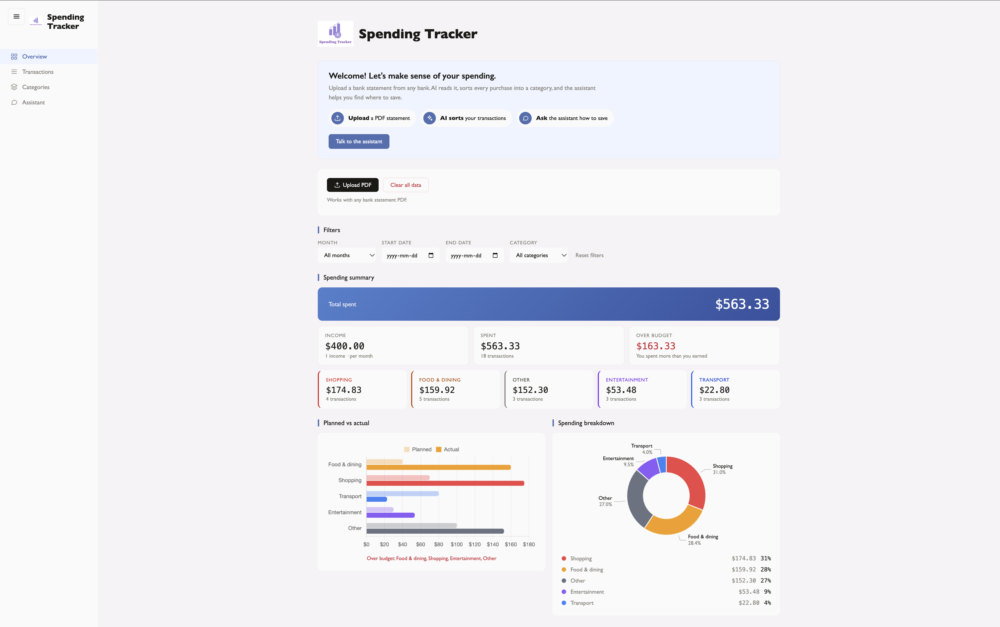
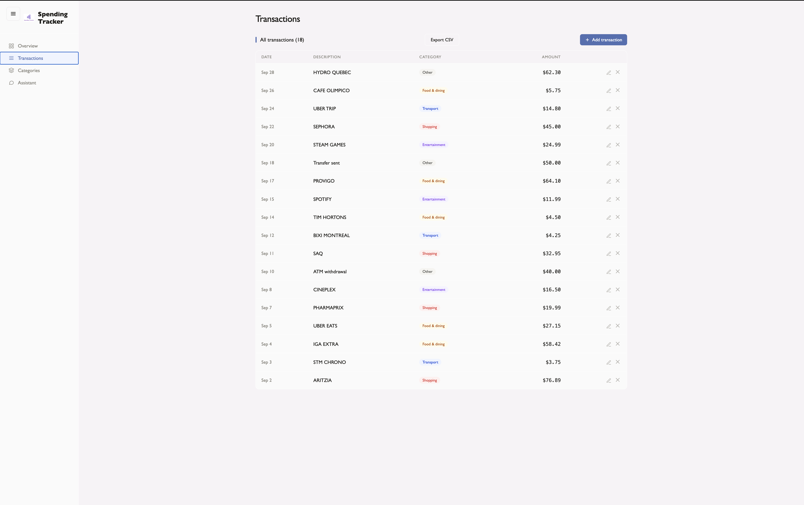
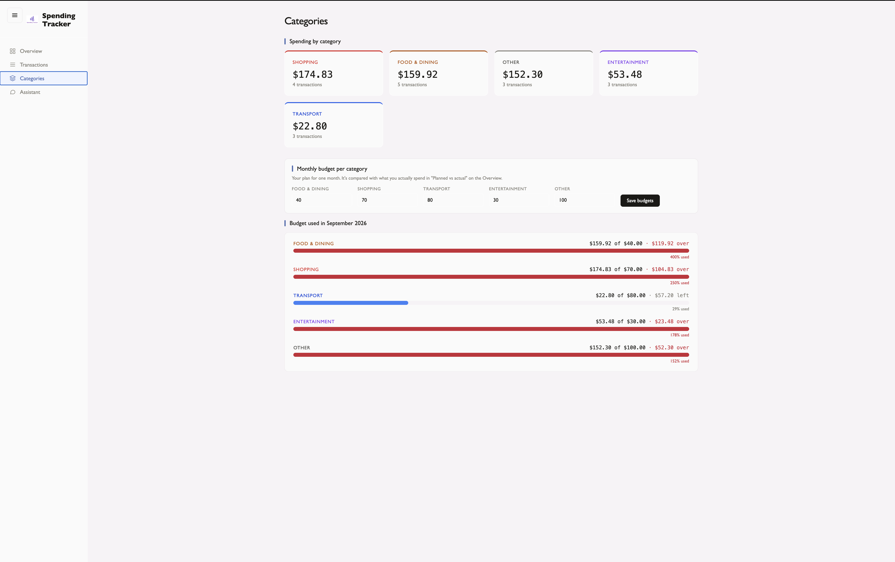
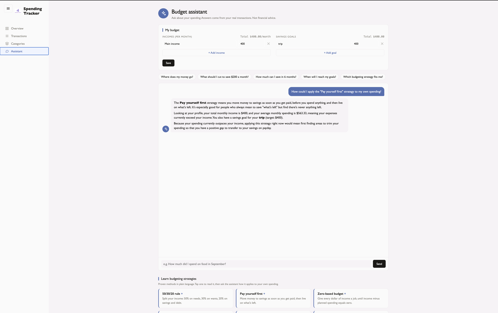

# Spending Tracker

A full-stack expense tracker with AI built in. Upload a bank statement from **any bank**: an LLM extracts and categorizes every transaction automatically, and a budget assistant (an AI agent with tool calling) answers questions about your spending using your real data.

## Live demo

- **App:** https://spending-tracker-m.netlify.app (frontend on Netlify)
- **API:** deployed on Vercel, database on Aiven (MySQL)

> The live demo uses fictional test data. Please don't upload a real bank statement there.

## Screenshots

### Dashboard


### Transactions


### Categories


### Budget assistant


## Features

### AI features
- **Automatic categorization:** every uploaded transaction is categorized by Gemini using structured JSON output, with validation, a retry and a rule-based fallback.
- **Any bank, any layout:** a fast rule-based parser handles RBC statements; for any other bank or layout, the LLM extracts the transactions from the PDF text.
- **Budget assistant (AI agent):** a chatbot that decides which tools to call (spending by category, top merchants, monthly totals, budget vs actual, savings projection), runs them on the database, and answers from the results. It replies in French or English.
- **Savings predictions:** projects savings from your incomes and average spending, simulates "what if" cuts, and estimates how long each savings goal would take.
- **Budgeting strategies (retrieval):** the assistant searches a small knowledge base of proven methods (50/30/20, pay yourself first, envelope method, sinking funds, debt avalanche and snowball...) and explains the relevant one using your real numbers. You can also browse them in the "Learn" section.

### Budgeting
- Multiple incomes and multiple savings goals (independent lists), with "left to save"
- Monthly budget per category, with **planned vs actual** chart and progress bars
- Month picker, date and category filters
- Add, **edit**, delete transactions, and **export to CSV**
- Spending breakdown donut chart
- Responsive layout for phone, tablet and desktop

## AI design decisions

**Why AI here.** Bank descriptions are messy (`SQ *CAFE BRULERIE 4492`) and new merchants appear constantly, so keyword rules break. Tagging 100+ transactions by hand every month is the kind of repetitive task worth automating. The original rule-based categorizer is kept as the fallback.

**Structured output + validation.** The model must answer in a fixed JSON schema (categories are an `enum`), and every answer is checked in code before it's saved: unknown categories, missing items, impossible dates (e.g. Feb 30) and unrealistic amounts are rejected. Structured output guarantees the *shape* of the answer, not that it's correct.

**Reliability.** Every Gemini call is retried once. If it still fails (e.g. a 503 under high demand, which happened during development), uploads fall back to the rules so the app never breaks.

**Privacy.** Only the description, date and amount are sent for categorization. Before a full statement is sent for extraction, every run of 5+ digits (account and card numbers) is masked as `#####`, and the text is capped in length to limit cost.

**Safety of the agent.** The assistant can only call a fixed list of tools, each running a predefined, parameterized SQL query. It never writes SQL itself; unknown tool requests are refused, and the loop stops after 5 rounds.

**Math stays in code.** LLMs are unreliable at arithmetic, so savings projections and goal timelines are calculated in `tools.js`. The model only decides when to use them and explains the result. While testing, the assistant once added two numbers itself; the instructions were tightened in response.

**Grounded advice (simple RAG).** When the assistant suggests a budgeting strategy, it first retrieves it from `strategies.js`, a knowledge base written and checked by hand, and builds its explanation from that content instead of inventing advice. Retrieval is keyword-based for now; embeddings and a vector search would be the next step as the knowledge base grows.

**Honest limits.** The assistant is not a financial advisor and says so. It only knows the user's spending, plus the income and goal they save in "My budget".

## Evaluation

Rules vs AI on a hand-labeled test set of 18 transactions (`backend/eval/`):

| Method | Accuracy | Time |
| --- | --- | --- |
| Keyword rules (original) | 7/18 (39%) | instant |
| Gemini, one batch call | 18/18 (100%) | 1.6 s |

The rules failed on any merchant not in their list (Aritzia, IGA, Cineplex...) and mislabeled Uber Eats as Transport. Run it yourself with `node eval/evaluate.js`.

This test set is small. The next step is evaluating on a few hundred real transactions to get a reliable number.

## Tech stack

- **Frontend:** HTML, CSS, JavaScript, Chart.js
- **Backend:** Node.js, Express.js, Multer, pdf-parse
- **Database:** MySQL (Aiven in production)
- **AI:** Google Gemini API (`@google/genai`): structured output, function calling
- **Hosting:** Netlify (frontend), Vercel (backend)

## How it works

**Upload pipeline** (`POST /upload`)
1. pdf-parse turns the PDF into text.
2. The RBC rule-based parser tries first. If it finds nothing, `extractor.js` masks sensitive numbers and asks Gemini to extract the transactions.
3. `categorizer.js` categorizes everything with Gemini; invalid answers keep the rule-based category.
4. Transactions are saved to MySQL.

**Assistant** (`POST /chat`)
1. The question and recent messages go to Gemini with the tool list (`chatbot.js`).
2. Gemini asks for a tool; the server runs it (`tools.js`) and sends back the result.
3. This repeats until Gemini writes the final answer (max 5 rounds).

## Project structure

```text
SpendingTracker/
├── backend/
│   ├── server.js          # Express app, routes, table setup
│   ├── categorizer.js     # AI categorization (schema, validation, retry)
│   ├── extractor.js       # AI extraction for any bank (masking, validation)
│   ├── rules.js           # Rule-based categorizer (fallback)
│   ├── chatbot.js         # Budget assistant: tool calling loop
│   ├── tools.js           # The only database queries the assistant can run
│   ├── strategies.js      # Budgeting strategies knowledge base + search
│   ├── eval/
│   │   ├── labeled.json   # Hand-labeled test set
│   │   └── evaluate.js    # Rules vs AI accuracy
│   └── package.json
├── frontend/
│   ├── index.html
│   ├── style.css
│   ├── app.js
│   └── images/
└── screenshots/
```

## Running locally

### 1. Clone and install

```bash
git clone https://github.com/micheleS2006/SpendingTracker.git
cd SpendingTracker/backend
npm install
```

### 2. Create `backend/.env`

```env
DB_HOST=localhost
DB_USER=root
DB_PASSWORD=
DB_NAME=spending_tracker
GEMINI_API_KEY=your-key-from-google-ai-studio
GEMINI_MODEL=a-gemini-flash-model-id
```

Get a free API key at [Google AI Studio](https://aistudio.google.com). Never commit `.env`.

### 3. Create the database

```sql
CREATE DATABASE spending_tracker;
USE spending_tracker;

CREATE TABLE transactions (
  id INT AUTO_INCREMENT PRIMARY KEY,
  date DATE NOT NULL,
  description VARCHAR(255) NOT NULL,
  category VARCHAR(100) NOT NULL,
  amount DECIMAL(10,2) NOT NULL
);
```

The `incomes`, `goals` and `budgets` tables are created automatically when the server starts.

### 4. Start

```bash
node server.js
```

Then open `frontend/index.html` with Live Server. It uses the local backend automatically.

## API endpoints

| Method | Endpoint | Description |
| --- | --- | --- |
| GET | `/transactions` | All transactions |
| POST | `/transactions` | Add a transaction |
| PUT | `/transactions/:id` | Edit a transaction |
| DELETE | `/transactions/:id` | Delete a transaction |
| DELETE | `/transactions` | Delete all (requires `{ "confirm": true }`) |
| POST | `/upload` | Import a bank statement PDF (AI extraction + categorization) |
| POST | `/chat` | Ask the budget assistant |
| GET / PUT | `/profile` | Incomes and savings goals |
| GET | `/strategies` | Budgeting strategies for the Learn section |
| GET / PUT | `/budgets` | Monthly budget per category |

## Next steps

- Evaluate on a larger, real test set and track accuracy over time
- User accounts and authentication, so each user only sees their own data
- Store income automatically from deposits in the statement
- Spending trends month over month, and debt payoff planning in the assistant
- Embedding-based search over the strategies, and RAG over past statements

## Author

Michèle Sossou
GitHub: https://github.com/micheleS2006